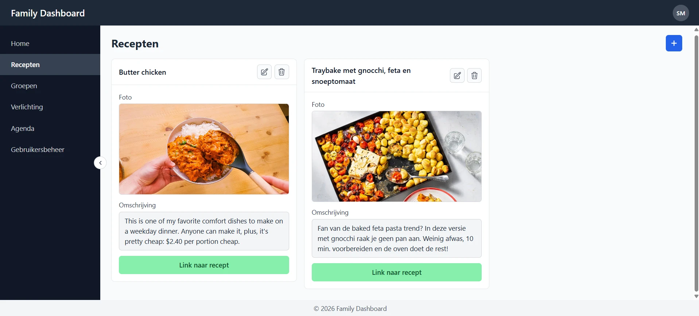
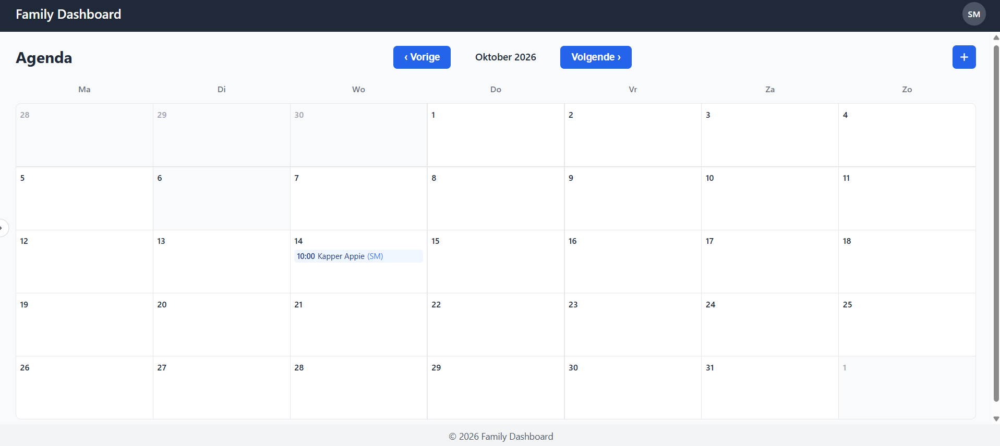

# FamilyDashboard

A self-hosted dashboard for my family, running on a Raspberry Pi at home.
It covers shared recipes, a calendar with private and group events, family
groups, and control of our Philips Hue lights.




## Stack

- **Frontend**: Angular 22 (standalone components, signals), with its own small component library and design tokens
- **Backend**: ASP.NET Core (.NET 10) Web API, EF Core, JWT authentication
- **Database**: PostgreSQL 17
- **Deployment**: Docker Compose, with nginx serving the frontend and proxying `/api` to the backend

## Running it

### With Docker

```bash
cp .env.example .env   # fill in the values
docker compose up -d --build
```

The app runs on port 80. On first startup the backend applies its migrations
and creates the `FDB-ADMIN` account, which can then create the other users.

### Local development

```bash
# Database
docker compose -f backend/docker-compose.yml up -d

# Backend (http://localhost:5252)
cd backend/FamilyDashboard.Api
dotnet user-secrets set "Jwt:SigningKey" "<long random string>"
dotnet user-secrets set "AdminUser:Password" "<password>"
dotnet run

# Frontend (http://localhost:4200)
cd frontend
npm install
npm start
```
